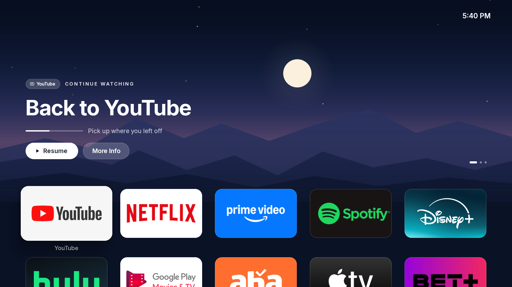
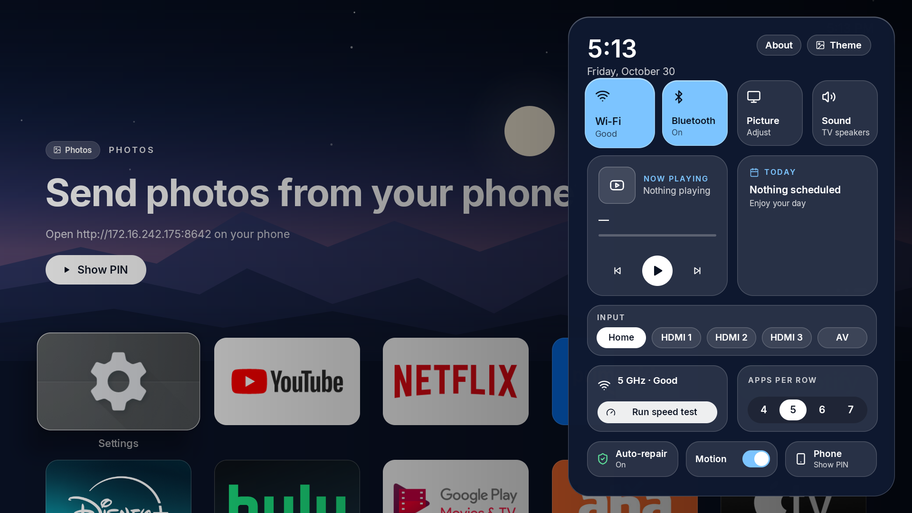
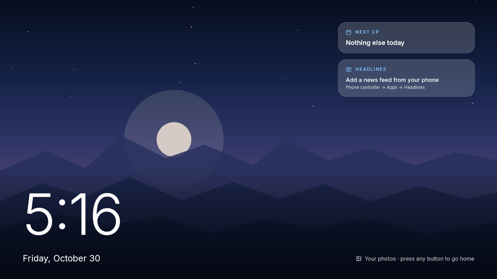

# Glass TV

A calm, ad-free home screen for **Android TV and Google TV** (Android 9 and newer), with a phone remote that only answers devices on your own Wi-Fi.

| Control Center | Ambient mode |
|---|---|
|  |  |

- Big glass app tiles with each app's real banner; the apps you use most move to the front
- Control Center from the remote's settings button: Wi-Fi, Bluetooth, Now Playing, today's calendar, inputs, speed test, 12 themes
- Ambient mode: a big clock, photos sent from your phone, sticky notes, your next event
- Phone remote in the browser: arrows, typing, voice search, messages, photos, links, apps and inputs
- No account, no cloud, no ads, no tracking. Nothing is ever uninstalled from your TV

## Install

Downloads are on the [latest release](https://github.com/saivikas373/glass-tv/releases/latest).

### Easy path (TV only)
1. On the TV, install **Downloader** from the Play Store.
2. Open Downloader and enter the link to `Glass.apk` from the release page.
3. Open Glass and follow its setup screen: **Turn on Glass**, **Show what's playing**, **Pick a look**, **Done: press Home**.

If step 1 of the setup says *"Your TV blocked this"* (common on Android 13+ for apps installed with Downloader), use the Full path.

### Full path (computer, also switches off ad and tracking apps)
1. On the TV: Settings → System → About → press OK on **Android TV OS build** 7 times, then Settings → System → Developer options → **USB debugging** on.
2. Download `Glass-TV-Setup-Mac.zip` or `Glass-TV-Setup-Windows.zip` and unzip it.
3. Double-click **Glass-Setup** (Mac: the first time, right-click → Open → Open. Windows: if SmartScreen appears, More info → Run anyway).
4. Type your TV's IP address when it asks, and press **Allow** on the TV.

It downloads Google's official ADB tool, backs up the TV, switches off a conservative list of ad and tracking apps (only if installed, never uninstalled), installs and turns on Glass, then **closes ADB** and deletes its key.
**Keep the folder: Glass-Restore undoes everything.**

### After a TV update
If Glass shows **"TV updated: run repair"**: Easy installs turn Glass off and on in Settings → Accessibility; Full installs turn USB debugging on and double-click Glass-Setup again.

## Security
The phone remote listens on the TV's Wi-Fi address only, refuses anything outside your home subnet, pairs each phone once with a 6-digit PIN shown on the TV (5 wrong PINs lock pairing for 5 minutes), and refuses DNS-rebinding and cross-site requests. App installs from a link need https and your confirmation on the TV. See `setup/security-test.sh`.

## Build
JDK 17 and the Android SDK (platform 34). `glass/build-release.sh` builds a signed `Glass.apk`; the keystore is never part of this repo. `setup/make-release.py` builds the setup zips from `setup/src`.

## Licenses
Glass TV is MIT licensed (`LICENSE`). The safe Home-switch approach and the ad/tracking package lists come from [CleanYourTV](https://github.com/Gathin23/cleanyourtv) (MIT, Copyright (c) 2026 Gathin). The Inter typeface is under the SIL Open Font License 1.1 (`FONT-LICENSE-OFL-Inter.txt`).

Not affiliated with Google, Apple or any TV maker.
